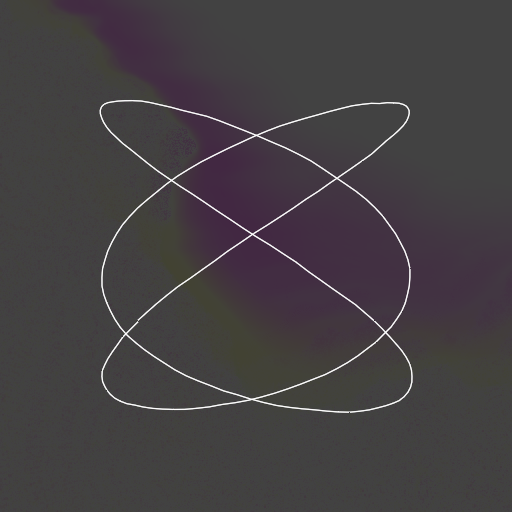
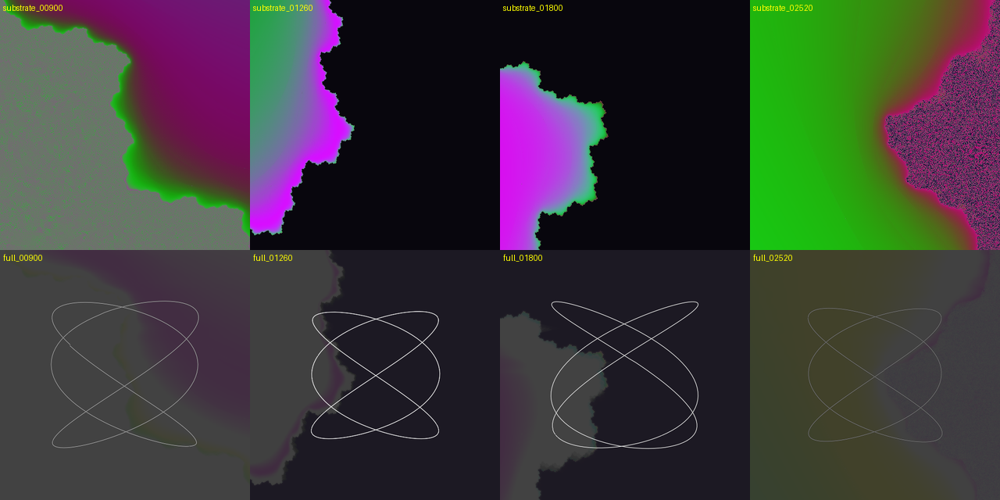
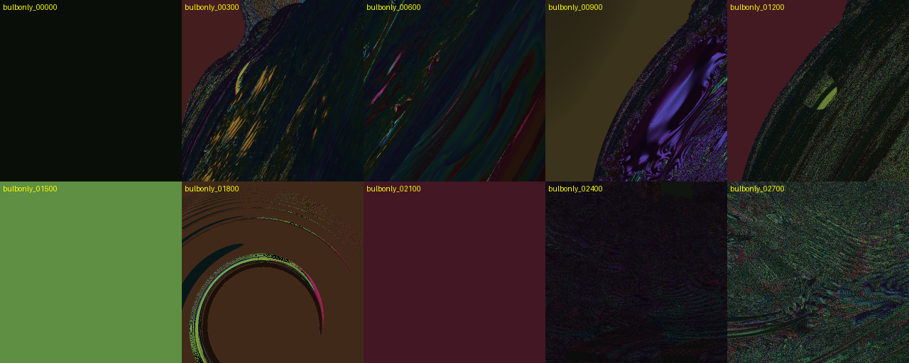

# synteza: project plan

Date: 2026-11-22. Audience: the owner and the coding agents that will execute.
Status: proposal. Items marked **Decision** are the owner's to make. Nothing here is a calendar promise.

**How to read this file.** Three kinds of statement are kept apart:

- **Fact**: verified in this repo's code or by rendering frames (path:line given; paths are relative to this repo unless prefixed).
- **Evidence**: from the research notes, cited by short name and carrying the note's own tag.
- **Rec**: a recommendation of this plan.

| Short name | Notes file (folder `research_notes/Kabl synteza afekt project plans/`) | Tags used there |
|---|---|---|
| brief | `00_coordinator_brief.md` | owner decisions and local facts |
| audit | `local_synteza_scene_audit.md` (+ `frames/*.png`) | [C] certain from code, [R] also seen in rendered frames, [L] likely |
| gvt | `generative_visual_techniques.md` | [V] confirmed from search snippets, [K] researcher's prior knowledge, not re-opened; "inference" = the note's own engineering judgement |
| market | `av_instrument_market.md` (round 1) | search extracts; "background knowledge, unverified" where marked |
| r2 | `round2_product_claims_verified.md` (round 2, wins over round 1) | CONFIRMED / PARTLY CONFIRMED / UNVERIFIED |
| msa | `music_structure_analysis.md` | verified from repositories; [snippet]; UNVERIFIED RECALL |
| ppt | `plugin_platform_tech.md` | search and repository extracts |
| VC, AVM | `kabl/docs/v2/VIDEO-CORE.md`, `kabl/docs/v2/AV-MERGE.md` | earlier engine design, partly superseded by brief §2 |

---

## 1. Summary

**Goal (owner's words, brief §1).** synteza is "part of kabl but also standalone, something artists would like to use,
primarily for music visuals but also more if possible. It is the visual part of my art journey/expression, so we need GOOD
and VARIED hysts by default (both the julia and mandelbulb are lacking right now)."

**Where it stands.** There is no runnable native visualizer. The Rust renderer is offline only, has one hard-wired look,
and that look renders as a flat grey field with a thin white line (§2.2). The only version that ever ran live is the frozen
TypeScript one. The repo has no licence file, no Rust CI, and a red clippy gate.

**The bet.** A small engine built on float (HDR) feedback, plus about 14 deliberately different hysts that all obey one
art rule (the image has memory and follows musical structure), will be worth more to artists than a large shader pack
or a patch editor. The library is the product; the engine exists to serve it and to become kabl's video core later.
The differentiator is the pairing of *memory in the image* with *structure in the control signals*, and for known tracks
an offline sidecar that makes the structure exact.

**Three biggest risks.**

1. **The looks still fail the owner's eye after the repair.** The last Julia tuning round was verified "never by opening a
   rendered image" (audit §0, citing `AGENTS.md:840`). Mitigation: every work order ends with a contact sheet the owner
   looks at; a hyst enters the default set only through a blind comparison (§4.5).
2. **"Structure-reactive" is over-claimed.** Live section detection has no published method (msa §2); live downbeats are
   roughly 20–30 F1 points worse than offline (msa §1). Mitigation: claim only what §6.4 lists; make the sidecar path the
   one that is exact.
3. **Engine work eats the art.** A frame graph, module trait and kabl integration can absorb months with nothing to see.
   Mitigation: a time-boxed look spike on the existing renderer in the first 30 days (§9), and S3's exit test is a look,
   not an API.

**Next 30 days (detail in §9).** Choose a licence. Do S0: move the afekt crates out, fix clippy, add Rust CI on a software
GPU, delete dead crates. Build the contact-sheet tool and record "before" renders. Run the look spike: float targets,
re-derived exposure, the TS decay range, the Julia glitch fix and a boundary `c`, judged by the owner by eye. Test the
competitor "Infinite" hands-on. Start S1 (engine core) only after S0 is green.

---

## 2. Where synteza stands (verified)

### 2.1 Repository facts

| Fact | Where |
|---|---|
| No licence file. | repo root (no `LICENSE*`, `COPYING*`); brief §1 |
| Ten Rust crates: `hyst-core`, `-audio`, `-render`, `-script`, `-choreo`, `-compile`, `-output`, `-hw`, `-previz`, `-cli`. | `Cargo.toml:3-14` |
| `hyst-render` uses wgpu 22 with the `glsl` feature. Offline only: no window, no surface. | `crates/hyst-render/Cargo.toml:10`; VC §0 |
| Every render target is `Rgba8Unorm`. | `crates/hyst-render/src/gpu.rs:125` |
| Every pass rebuilds shader modules, layout and pipeline on each call ("deliberate, unoptimized"). | `crates/hyst-render/src/passes/mod.rs:18-23` |
| One hard-wired pipeline: Julia → memory field → persistence → bright pass → blur → composite → beam. | `crates/hyst-render/src/renderer.rs:112-190` |
| The `.hyst` parser works but nothing runs it. It rejects persistent buffers, multipass (without `HYSTERESIS_VERSION`), imported images and image inputs. | `crates/hyst-render/src/hyst_format/parse.rs:66-67, 75-76, 93-94, 132`; `hyst_format/mod.rs:1-5` |
| `hyst-audio` plays WAV files only; the callback allocates and the bus sits behind a `Mutex`. | `crates/hyst-audio/src/playback.rs:15, 60, 148` |
| Build, drop and break detectors are not ported; `buildProgress`, `tension`, `suspension`, `dropImpulse` stay 0. | `crates/hyst-audio/src/features.rs:11-17` |
| `hyst-script` creates an unsandboxed `Lua::new()` and is wired to nothing. | `crates/hyst-script/src/lib.rs:33`; VC §1 |
| `hyst-choreo` has no dependents. `hyst-compile` depends on `hyst-core`. `hyst-previz` and `hyst-cli` depend on `hyst-compile`. | `crates/*/Cargo.toml` |
| No Rust CI. The only workflows are an npm Pages deploy that triggers on a `main` branch that does not exist, and a site notifier. | `.github/workflows/deploy.yml:4-5` |
| Clippy is red: two `manual_is_multiple_of` errors in `passes/julia.rs`. | `docs/STATE.md` "Next" item 1 |
| Tests: 228 green with `--exclude hyst-render`; render tests need a GPU. | `docs/STATE.md` |
| The README still describes the TS package (`init(canvas, …)`). `AGENTS.md` is a 1,627-line log from the Hysteresis era. | `README.md:1-30`; `AGENTS.md` |
| The frozen TS/WebGL2 tree (`src/`, `tools/`) is the only version that ran live. It has float buffers, the structure detectors, the Julia autopilot, the `.hyst` host, and DMX/Art-Net/sACN/ILDA/OSC/MIDI code. | brief §3; audit §3 |
| The Rust examples live in `crates/hyst-render/examples/` (the audit writes `examples/…`; top-level `examples/` holds only `isf/*.hyst`). | `ls` |

### 2.2 Rendered-frame diagnosis

**Fact (audit §0).** Frames were rendered on software Vulkan (lavapipe) through the public API, with a synthetic 96 s,
124 BPM track. Nothing was checked on a hardware GPU. Three of the audit's sheets are copied into this repo.

**Julia, full pipeline, frame 585.** A flat grey field with a faint violet smear and a thin white Lissajous line.

**Julia, raw substrate (top) against full pipeline (bottom), 30 s to 84 s.** The substrate is one wiggly edge between two
flat colour fields, with speckle in the interior (frames 900 and 2520). The pipeline turns it into grey.

**Mandelbulb dive, every 300th frame.** Frames 0, 1500 and 2100 are a single flat colour. No frame shows the bulb.

### 2.3 Causes, with code locations (all from audit §1–§2)

| ID | Defect | Cause | Where | Tag |
|---|---|---|---|---|
| P1 | Julia arrives as flat grey | The memory field's `cur_gain` drives steady state to about 7.14× the input and the shader clamps at 64, but the target is 8-bit, so any channel above 0.14 saturates. Exposure 0.035 was tuned for the HDR range; after tonemap the ceiling is 55–69 out of 255. Measured: saturation 0.19 in the pipeline against 0.62 in the substrate; median 35% of pixels in one grey band. | `passes/memory_field.rs:18, 45, 149`; `gpu.rs:125`; `examples/audio_driven_render.rs:296`; `passes/composite.rs:51-53` | [R] |
| P2 | Almost no hysteresis | Demo decay is 0.55–0.75, a trail of 2–4 frames. TS uses 0.86 at rest, 0.965 in builds, up to 0.985 in breaks. | `examples/audio_driven_render.rs:269-299`; `src/render/conductor/patchbay/screen-composites.ts:25-27` | [C] |
| P3 | Flow advection mostly dead | Noise is three sines in a 64² 8-bit texture, sampled through a clamp-to-edge sampler, so three quarters of the screen reads a clamped edge. | `passes/noise_texture.rs:31-33`; `gpu.rs:73-74`; `renderer.rs:124-125` | [C] |
| P4 | Beam is a thin line, no glow, no trail | Drawn after tonemap as an overlay; TS draws it into the field. | `renderer.rs:181`; `src/render/conductor/outputs/ScreenOutput.ts:185` | [R] |
| P5 | Bloom is a 4-pixel blur | One 9-tap blur each way at full resolution. | `passes/bloom.rs:79-92` | [C] |
| P6 | No structure signals | Detectors not ported; symmetry is gated on energy instead and was on for 29% of the test clip, including the quiet intro. | `crates/hyst-audio/src/features.rs:11-17` | [C] |
| P7 | Audio/video drift | `hop_stride` rounds 2.87 hops to 3: about 4 s over 90 s. | `examples/audio_driven_render.rs:54-55` | [C] |
| J1 | Interior speckle | The pipeline always uses the perturbed shader and the driver aims the reference at an *escaping* point; once the reference escapes, longer-lived pixels cancel catastrophically. The direct shader is clean. | `renderer.rs:106-112`; `passes/julia.rs:478, 535` | [R] |
| J2 | `c` parked inside the main cardioid | `c` starts at (−0.05, 0.5) and moved less than 0.02 in 30 s; the set is a quasi-circle with no spirals or dendrites. | `passes/julia.rs:360-362, 286-292` | [R] |
| J3 | No variation over a song | One dive, one `c`, one palette for about 170 s; `flash` is hard-wired to 0, so no beat reaches the fractal. | `passes/julia.rs:255-272, 352` | [C] |
| J4–J6 | Flat areas, garish hue pairs, aliasing | One cosine palette on `sqrt(smoothIter)`; one sample per pixel; `aaFade` greys detail out instead of resolving it. | `passes/julia.rs:983-996, 1022` | [R] |
| M1 | Flat-colour Mandelbulb frames | Anchor found with 24 iterations, render starts at 8; the 8-iteration solid is fatter, so the camera starts inside it and every ray "hits" at step 0. Frame 0 is flat for any track. | `passes/mandelbulb.rs:1563, 1650` | [R] |
| M2 | The viewer never sees a Mandelbulb | The camera sits `0.045·exp(−log_pos)` from the surface from the start. | `passes/mandelbulb.rs:1520-1540` | [R] |
| M3 | Depth cues switch off at dive scale | Depth falloff and AO use fixed world-space distances. | `passes/mandelbulb.rs:1298-1308, 1370-1386` | [C] |
| M4 | Glow becomes a flat slab | Glow floor 0.006 is larger than every step distance in the dive. | `passes/mandelbulb.rs:1370-1386` | [R] |
| M5 | Dark and muddy | No tonemap or gamma; linear colour goes straight into 8-bit. | `passes/mandelbulb.rs:1429` | [R] |
| M6 | Speckle and oil-slick bands | `smoothIter` is ill-defined for points that never escape; the clamp adds 2.8 palette cycles. | `passes/mandelbulb.rs:1206-1207` | [C/L] |
| M7 | Cost | 4 samples × up to 360 steps × up to 24 trig iterations; the owner measured 86–111 ms at 1024². | `passes/mandelbulb.rs:1284-1286, 1416-1428`; VC §1 | [C] |

**Fact.** The direct Mandelbulb pass (`MANDELBULB_GLSL`, tests only) shows a recognisable, detailed bulb; it is too dark
but is the better asset (audit §2, sheet `mandelbulb_wide_direct_4frames.png` in the notes folder).

**What this means.** The owner's judgement that both scenes are lacking is correct, and most of the Julia failure is not
in the fractal. It is in the output chain (P1, P2, P5), which every future hyst would inherit. Fixing the chain comes first.

---

## 3. Art direction as testable rules

### 3.1 The thesis (keep)

**Fact (owner's text, `README.md:3-7`, `docs/LEGACY_TS.md:44-56`).** Hysteresis: the image accumulates history, so the
screen is a record of the last few seconds of the song. It winds up in builds, releases on drops, and is suspended in
breaks. Symmetry is "earned". Parameters are driven through springs and integrated rates, never raw features. "If a
visual element isn't wired to memory/energy/event state, it doesn't ship." The stated moat is musical understanding,
not the renderer.

### 3.2 Rules

Each rule has a test an agent can run and a view the owner can judge.

| # | Rule | Source | Test |
|---|---|---|---|
| A1 | **Memory.** Every default hyst has state that outlives the input by seconds (feedback field, simulation, trail, accumulated phase). | thesis | Cut the audio to silence mid-track: the image keeps changing for at least 2 s and does not snap to a rest frame. |
| A2 | **Wind-up, release, suspension.** Memory length follows structure. Feedback hysts start from the TS range: decay 0.86 at rest, 0.965 in builds, up to 0.985 in breaks. | Fact, `screen-composites.ts:25-27` | Plot the memory parameter against the sidecar's section track for a reference song; it rises through builds and holds in breaks. |
| A3 | **Earned symmetry.** Symmetry folds only the sampling coordinate of the field and is zero unless tension or a drop asks for it. | thesis; audit §3 | On a reference track, symmetry is non-zero only inside build and drop windows. The audit's 29%-of-clip-including-intro result must not recur. |
| A4 | **No raw features on geometry.** Any signal that moves position, scale, camera or simulation parameters passes through a spring or an integrator. | thesis; gvt §5 inference ("integrated phase is the single most important trick") | Feed a step in the input: no position discontinuity between frames. The `.hyst` loader warns when a raw signal is bound to a parameter tagged `motion`. |
| A5 | **Onsets to light, phase to motion.** Onset pulses and envelopes drive brightness, emission, beam intensity and small displacement. Beat, bar and phrase phase drive motion and change. | gvt §5 inference | Review the binding table of each hyst (§4.2 columns). |
| A6 | **Time scales.** Onset (tens of ms) → flashes, bursts, feedback kick. Beat (0.3–1 s) → pulses, eased steps, light direction. Bar (2–4 s) → sweeps, pattern alternation. Phrase (8–32 bars) → parameter drift, palette rotation, camera journey. Section → intensity budget and sub-look. | gvt §5 inference | Each hyst declares at least one binding at three or more of the five scales. |
| A7 | **Four signal types per band**: onset pulse, envelope, integrated phase, presence. | gvt §5: MilkDrop `bass`/`bass_att` and a music-driven clock [V]; Synesthesia uniform names [V], their semantics [K] | The signal bus exposes all four for each band; unit tests on synthetic input. |
| A8 | **Intensity budget.** One global 0–1 intensity from section state scales brightness ceiling, colour count, motion and element count. Breaks sit low; the bar before a drop may go near black. "A drop only reads as a drop if the preceding state withheld something." | gvt §5 inference; build/drop description in Solberg 2014 [K] | Mean luminance and motion energy per section on a reference track: break < groove < drop. |
| A9 | **Picture must not trail the sound.** A visual accent may not land later than about 45 ms after the audible event; picture leading is tolerated up to about 125 ms. Rhythmic events are scheduled from predicted beat phase, not from detected onsets. The app has an A/V offset control. | ITU-R BT.1359-1 via gvt §5 [V] (snippet level; one report uses the opposite sign convention). msa §8 could not open the ITU text and treats millisecond thresholds as unverified, so this is a working target. | Measure end-to-end latency per output path (analysis window + smoothing + render + display) with a click track and a camera. |
| A10 | **Flash limit.** No more than three full-field flashes in any one second. A global flash limiter (maximum luminance slew for large areas) is on by default. | WCAG 2.3.1 via gvt §5 [K]; Spotify Canvas guidance to avoid intense flashing, r2 §11 (secondary guide) | Offline check over golden renders: count large-area luminance swings per second. Note from gvt: a flash on every beat passes only up to 180 BPM; subdivisions never pass. |
| A11 | **Congruent mappings.** Loudness → brightness, size, density, bloom. Pitch height → vertical position, finer detail. Brightness and noisiness of the sound → sharpness, grain, angularity. Pitch → hue is never the primary mapping. | gvt §5: Spence 2011 [V], Spence and Di Stefano 2022 [V], Walker [V] | Review of binding tables. |
| A12 | **Colour.** Palettes are 3–5 OKLCH stops with a deliberate lightness ramp and a limited hue span, interpolated in OKLab, with one accent hue kept for onsets and drops. Hue rotation happens at constant lightness and chroma. No full-saturation rainbow. | gvt §4 inference; OKLab properties [K]; audit J5 | Palette files validate; brightness does not pump when hue rotates. |
| A13 | **Still-frame, silence and legibility.** Any paused frame is acceptable (composition, value range, no clipping or banding). The hyst stays interesting for five minutes without audio. A kick, a hat and a section change each have an obvious response. | gvt §6 inference ("a proposed acceptance test, not a sourced standard") | Contact sheet of random frames; five-minute silent render; three short test clips. |
| A14 | **Foreground and atmosphere.** In the flagship, the beam is the hero and the fractal is a dim atmosphere with visible structure. | Fact: TS multiplies the Julia by 0.35 (`src/render/worker/scenes/julia/shaders/julia.frag.glsl:125`, audit §3) | Owner's eye on the flagship golden. |

---

## 4. The hyst library plan (centrepiece)

### 4.1 Repair plans

Both plans start from the shared output chain. HDR targets and the post chain are built once (§4.3, phase S1) and are
proved early by the look spike on the existing renderer (§9, WO-7).

#### Julia (flagship: the look the thesis was written for)

| Pri | Change | Fixes | Acceptance by eye (same frame indices as the evidence sheets) |
|---|---|---|---|
| 1 | **HDR targets.** `Rgba16Float` for field, persistence and bloom. | P1 | The pipeline row of the contact sheet shows the colours of the substrate row, not grey. |
| 2 | **Exposure, bloom, tonemap, dither.** Re-derive exposure for the real range; mip-chain bloom; a tonemap that keeps hue for saturated emissive colour (AgX-style) in place of per-channel Reinhard; dither before 8-bit output. | P1, P5 | No frame has a large area in one grey or one clipped band; dark gradients show no bands on the owner's projector or monitor. |
| 3 | **Remove the perturbation glitch.** Direct iteration above zoom ≈ 1e-4; below it, a non-escaping reference with rebasing. | J1 | Zero speckle in the interior on every sheet frame. |
| 4 | **Restore hysteresis.** TS decay range (A2); tileable fbm flow noise with a repeat sampler; the beam drawn HDR and additive *into* the field so it leaves trails and feeds bloom. | P2, P3, P4 | With the sound cut, the image visibly remembers the last seconds; the beam glows and smears along the flow. |
| 5 | **Framing and navigation.** Put `c` on the Mandelbrot boundary: port the TS cardioid sweep and vortex search, or begin with a curated list (dendrite `i`, rabbit −0.123+0.745i, seahorse −0.75+0.1i, Siegel −0.391−0.587i) and move between entries at section changes. | J2, J3 | Spirals, dendrites or filaments in at least 8 of 10 sheet frames; no frame is "two flat fields and one edge". |
| 6 | **Colouring signals.** Carry the derivative; output smooth count, pixel-normalised distance and normal angle. Filaments from distance; stripe-average or orbit-trap as a second palette coordinate; interior from final-orbit or trap colour; per-frame log-range normalisation so depth does not flatten the picture; OKLab palettes per section. | J4, J5 | Fine dark hairlines at every zoom depth; no magenta-beside-green; the look holds from zoom 1 to 1e-6. |
| 7 | **Lighting.** Slope ("3D-look") lighting from `z/dz`, light azimuth tied to bar phase. | J4 | The exterior reads as relief, and the light visibly turns once per bar. |
| 8 | **Anti-aliasing.** 4× rotated grid or jittered temporal accumulation; delete `aaFade`. | J6 | Busy regions resolve into detail instead of greying out. |
| 9 | **Structure-driven motion.** Wind-up drives zoom rate; a drop jumps `c` and steps the palette; tension slows drift; beats drive `flash`. | P6, J3 | The owner can point at the build, the drop and the break in a silent replay of the video. |
| 10 | **Performance.** Pipeline cache; iteration budget that grows with depth. | `passes/mod.rs:18-23`; audit §5 item 8 [L] | Holds the frame-rate target of its cost class on the reference laptop (measured, not assumed). |

Techniques in rows 3, 6, 7 are from audit §5 and gvt §1 (formulas [K]; Wikibooks stripe-average and DEM pages [V]).
Formulas tagged [K] must be checked against the primary page before they are quoted in code comments.

#### Mandelbulb: fix or replace?

**Verdict (Rec): replace the dive, keep the bulb as one formula.**

- Retire `MANDELBULB_PERTURBED_GLSL` and `MandelbulbInfiniteDiveDriver` from the default set. The path is about a
  thousand lines of perturbation with CPU-side Jacobians, it produced the flat frames (M1), and a surface dive never
  shows the object (M2). Keep the code in history, not in the library.
- Build **one shared distance-field ray-marcher** and make fold-based fractals the 3D heroes: Mandelbox, kaleidoscopic
  IFS, Menger variants, pseudo-Kleinian. Evidence: these need no trigonometry or `pow`, use a scalar running derivative,
  and "give far more varied architecture per millisecond" than the bulb, which is "the most expensive and least
  flexible member of the family" (gvt §2 takeaway; Syntopia series [V], formula code [K]).
- Keep the Mandelbulb as **one formula inside that marcher**, shown as a sculpture: wide-to-macro orbit on the direct
  distance estimate, which already yields a recognisable bulb (audit §2). It then inherits lighting, fog and
  temporal reconstruction for free.

Honest limits: no technique here has been benchmarked on an integrated GPU (gvt §2 gaps). The speed-up route in gvt §2
is an estimate; the fold family could still land in the heavy cost class.

| Pri | Change (applies to the shared marcher; bulb-specific items marked) | Fixes | Acceptance by eye |
|---|---|---|---|
| 1 | **Framing and navigation.** Camera outside the set by construction; speed proportional to `DE(camera)`; one iteration count for anchor and render (bulb); first frame shows the whole object. | M1, M2 | Zero flat frames in a 10-frame sheet. Frame 0 shows the whole form. In at least 8 of 10 frames a stranger can say it is a solid object in space. |
| 2 | **Linear HDR out into the shared bloom and tonemap.** | M5 | Mid-tones are visible; the picture is not "dark and muddy" on the owner's display. |
| 3 | **Scale-relative everything.** Pixel-footprint termination; AO radii, fog and glow floor proportional to camera distance. | M3, M4 | Depth reads at every distance; the background is never one flat slab. |
| 4 | **Lighting.** Tetrahedral four-tap normals; soft shadow from the march; coloured key, fill and rim; specular with fresnel; exponential fog tinted toward the light; step-count glow as HDR emissive. | flat Lambert, audit §1 | The form has a lit side, a shadow side and a rim; near and far separate by colour. |
| 5 | **Orbit-trap colour** (minimum `|z|` and per-axis minima into a gradient texture; no `smoothIter` on surfaces). | M6 | No speckle or oil-slick banding; "glowing seams" where the trap maps to emission. |
| 6 | **Performance.** One sample plus temporal accumulation; bounding-sphere ray start; over-relaxed stepping; half-resolution march with jitter and depth-aware upsampling; trig-free power-8 polynomial (bulb). | M7 | Holds its cost-class target, measured. History weight drops when shape parameters move fast (gvt §2 inference), so fast audio goes to light, colour and fog, and slow audio to shape. |
| 7 | **Variation.** Formula selector with 2–3 curated parameter sets each; power morph with wind-up for the bulb (TS had `8 + 1.5·windup`, `MandelbulbScene.ts:79`). | J3-equivalent | Three sub-looks that the owner would not confuse with each other. |

Sources: audit §5; gvt §2 (enhanced sphere tracing [V]; low-resolution march with temporal reconstruction [V]; soft
shadow, normals, fog formulas [K]).

### 4.2 Proposed default library

Fourteen hysts plus two optional ones, chosen so that no two share a niche (spread follows gvt §6 inference). Names are
placeholders. **Cost class is an estimate for 1080p on an Iris Xe / Apple M1 class GPU; nothing has been measured**
(gvt §3 gaps): **L** light (expected at full resolution), **M** medium (needs a reduced simulation grid or agent count),
**H** heavy (needs half-resolution marching with temporal reconstruction; left out of automatic rotation on integrated
GPUs until measured). Every hyst ships 3–6 sub-looks (parameter set + palette + post look + per-section choreography);
"sub-looks beat scene count" (gvt §6 inference).

Signals column: **O** onset, **B** beat phase, **Bar**, **P** phrase, **S** section, **E** envelope/presence.

| # | Placeholder | Character | Look in one line | Core technique | Music → picture, by time scale | Cost (est.) | Licence-safe references | Wave |
|---|---|---|---|---|---|---|---|---|
| 1 | `julia-memory` | fractal 2D, flagship | Dim violet filament fractal smeared by a flow field, bright oscilloscope beam writing into it | Escape-time Julia with distance and slope shading → HDR flow feedback; sub-looks: Burning Ship, Phoenix | O → beam intensity, flash. B → light azimuth step. Bar → field breathing. P → `c` drift along boundary. S → decay range, earned symmetry, palette, `c` jump on drop | M | own TS code; IQ articles (MIT [V]); Wikibooks; Chéritat [K] | A |
| 2 | `scope` | line, minimal, mono | One phosphor beam: XY Lissajous from stereo, polar waveform, wire shapes | Gaussian-beam segment integral; phosphor persistence in HDR feedback; bloom | O → beam gain. E → persistence. Bar → figure rotation. S → figure change, XY ↔ polar | L | own `passes/beam.rs`; woscope article [K, licence unverified: use as idea only] | A |
| 3 | `signal` | feedback / video-synth | Saturated analog-style bands and keyed feedback spirals | 2–3 oscillators cross-modulated, soft luma key, colouriser, feedback with zoom/rotate/hue at gain near unity, soft limiter | O → key threshold kick. B → sync wobble. Bar → rotation cycle. P → oscillator ratio drift. S → gain regime (decay / unity / bloom-out) | L | Crutchfield 1984 [K]; MilkDrop authoring guide [K] and Hydra (AGPL [K]) for ideas only | A |
| 4 | `marble` | painterly, calm | Slow relief-lit marble or smoke | Domain-warped fbm treated as a height field, lit | E(bass) → warp amplitude. P → inner-layer phase from integrated energy. S → palette position, light height | L–M | IQ warp/fbm articles (MIT [V]) | A |
| 5 | `raster` | geometric, data-minimal, black and white | Bars, barcodes, grids, moiré fields locked to tempo | Analytic anti-aliased gratings; two or three near-equal gratings for moiré; native resolution, no temporal AA | O → local invert in small areas only (A10). B → pattern index step. Bar → grating angle sweep. S → density | L | IQ filterable procedurals (MIT [V]); Golus grid article [K, idea only] | A |
| 6 | `ink` | fluid simulation, colour | Ink in water, marbling | Stable fluids: advect, Jacobi pressure, vorticity confinement; HDR dye at higher resolution than velocity | O(kick) → radial jets; O(hat) → small splats. E → emitter rate. Bar → emitter layout. S → dissipation (short tails in busy sections, long in breaks), vorticity up in builds | M | Stam 1999, Harris GPU Gems 38 [V]; Dobryakov WebGL fluid (MIT [V]) | B |
| 7 | `coral` | simulation, organic, duotone | Growing coral and fingerprint patterns with relief | Gray-Scott reaction-diffusion, 9-point Laplacian, 8–20 sub-steps; shade B as height | O → local injection of B. B → sub-steps pulse. P → walk along an authored path in the (f, k) map. S → "species" change; low-rate reseed | L–M | Karl Sims tutorial [V]; mrob xmorphia [V] | B |
| 8 | `fold-city` | 3D space, architectural | Fly-through of a dark folded city with glowing seams | Shared marcher; Mandelbox / KIFS / Menger selector; orbit-trap emission; fog | O → seam emission. B → light direction step. Bar → camera roll sweep. P → fold parameters and route. S → formula or parameter-set change | H | Syntopia series [V] (formula code [K]); Keinert 2014 [V] | C |
| 9 | `bulb` | 3D sculpture | The Mandelbulb as a lit object, wide to macro | Same marcher, direct distance estimate, trig-free power 8 | O → rim light. B → key light step. P → orbit and approach. S → power morph with wind-up | H | IQ Mandelbulb article (MIT [V]); own direct pass | C |
| 10 | `cavern` | 3D space, hypnotic | Endless beaded cavern or tunnel, pearl-like | Same marcher; fold + sphere inversion (pseudo-Kleinian / Apollonian) | O → fog glow. B → forward speed pulse from integrated phase. Bar → twist. S → inversion radius, palette | H | Syntopia [V]; Leys 2017 paper [K]; write from the maths, do not copy Shadertoy code | C |
| 11 | `soft-body` | 3D, tactile, studio-lit | A few soft blobs merging and parting, translucent | Same marcher; SDF primitives with smooth union; cheap translucency | O → surface ripple. E(bass) → smooth-union radius (blobs merge). Bar → slow orbit. S → count, material | M | IQ distance functions, smin (MIT [V]); hg_sdf licence conflicting reports [K]: do not copy | C |
| 12 | `mycelium` | agents, filigree, mono or duotone | Vein and mycelium networks that re-route | Physarum agents in a compute shader + diffusing trail map | O → deposit burst. E → step size. P → sensor angle and distance drift (fine mesh ↔ highways). S → respawn fraction, attractor field from spectrum | M | Jones 2010 [V]; Jenson write-up [K, idea only] | D |
| 13 | `flame` | particles, luminous | Silk-like attractor or flame filigree | Chaos-game points into a compute histogram, log-density tonemap, temporal accumulation | O → exposure kick. Bar → coefficient interpolation step. P → walk between curated coefficient sets. S → set family, palette | M | Draves and Reckase paper [V]; Bourke pages [K]; flam3 licence not retrieved: do not copy code | D |
| 14 | `ridgeline` | data-like 3D, minimal, mono | Scrolling spectrogram as stacked ridgelines or terrain | Audio-history texture (rows per beat subdivision) displaced as instanced lines with occlusion | O → line brightness. B → row advance (tempo sets the geometry). Bar → camera tilt. S → frequency warp, line count | L–M | own design; no verified reference retrieved (gvt §3 gaps) | E |
| 15 | `tessera` (optional) | geometric tiling | Cells or hyperbolic tiles lit like pads | Voronoi with edge distance, or fold-into-fundamental-domain tiling | O → per-cell flash by band (small areas). Bar → metric or Möbius drift. S → cell scale | L | IQ Voronoi articles (MIT [V]); no verified tiling reference | E |
| 16 | `glyph` (optional) | typographic | Track title, cue words or timecode as animated type | MSDF text, per-glyph springs, beat-quantised changes | O → glyph jitter. B → word step. S → layout | L | msdfgen (MIT [K]) | E |

**Processors** (apply to any hyst; each multiplies the number of looks, gvt §3 cross-cutting inference): scan-line
displacement (Rutt-Etra style), slit-scan / time displacement, earned-symmetry fold, feedback/echo, glitch as a short
transition only. Build after wave B.

**Looks to avoid or reinterpret** (gvt §6; the note states this list is opinion, no source ranks clichés): spectrum bars
and rings, raw-amplitude scale pulsing, rainbow HSV cycling, sunset-grid synthwave, default-palette Mandelbrot zoom,
kaleidoscope over anything, heavy uniform chromatic aberration.

**Build order (Rec).** Waves follow the building blocks, so each wave needs one new piece of infrastructure.

| Wave | Hysts | New infrastructure needed | Phase |
|---|---|---|---|
| A | `julia-memory`, `scope`, `signal`, `marble`, `raster` | HDR feedback, bloom, tonemap, palette, noise, dither | S3 |
| B | `ink`, `coral` + first processors | ping-pong float simulation targets with their own resolution | S3–S4 |
| C | `fold-city`, `bulb`, `cavern`, `soft-body` | shared marcher, temporal reconstruction | S4 |
| D | `mycelium`, `flame` | compute-shader agents and histogram | S4 or 1.1 |
| E | `ridgeline`, `tessera`, `glyph` | audio-history texture, instanced lines, text atlas | 1.1 |

### 4.3 Shared building blocks

| Block | What | Why (defect or evidence) | First needed |
|---|---|---|---|
| HDR feedback | `Rgba16Float` targets from a pool; explicit previous-frame edges; ping-pong owned by the scheduler | P1; "8-bit feedback buffers leave residue that never decays" (gvt §3, §4 inference); VC §2.3 | S1 |
| Bloom chain | Down/up-sample pyramid from half resolution, no hard threshold, firefly suppression on the first downsample | P5; Jimenez 2014 [V], dual filter [V], LearnOpenGL recipe [K] | S1 |
| Tonemap and output | Exposure → AgX-style tonemap (second "punchy" option) → grade → display encoding → grain → dither | P1, M5; "notorious six" hue skew of per-channel curves [V] | S1 |
| Dither | Triangular or blue-noise dither sized to output bit depth, last step | Gjøl [V], Wronski [V]; blue-noise textures CC0 [K, verify] | S1 |
| Palette module | OKLab/OKLCH gradient textures, one shared shader function through an include mechanism, a palette library, one accent slot | `palette()` is pasted four times (`julia.rs:982, 1126`; `mandelbulb.rs:600, 1314`); A12 | S1 |
| Noise | Tileable fbm, curl and blue-noise textures; repeat and mirror samplers | P3 | S1 |
| Control | Spring-damper, integrator, easing curves, frame-rate-independent smoothing; real `TIME`, `TIMEDELTA`, `FRAMEINDEX` | A4; port from TS `choreography/` and `hyst-choreo/src/curve.rs` (VC §1) | S1 |
| Audio textures | Waveform ring, spectrum, spectrogram history | `scope`, `ridgeline`; gvt §3 cross-cutting | S2 |
| Simulation targets | Ping-pong float targets with configurable resolution and sub-steps | `ink`, `coral` | S3 |
| Temporal reconstruction | Jittered accumulation with neighbourhood clamping; history weight tied to parameter velocity | J6, M7; Playdead reference (MIT [K]); low-res march reconstruction [V] | S4 |
| Shared ray-marcher | Camera, pixel-footprint termination, over-relaxation, normals, soft shadow, AO, fog, materials, formula slot | §4.1 verdict | S4 |
| Compute support | Agent buffers, point deposit / rasterise, atomic histogram | `mycelium`, `flame`; a wgpu flame renderer is the note's inference, no cited implementation (gvt §1) | S4 / 1.1 |
| Frame-history ring | N past frames at reduced resolution | slit-scan processor (memory cost example in gvt §3) | 1.1 |
| Contact-sheet tool | Small-resolution render of fixed frame indices to one PNG, plus A/B video | risk 1; audit §5 last item | S0 |

### 4.4 Reference tracks and golden renders

**Rec.** Keep a small fixed set and never tune a hyst on one song.

| Slot | Why | Candidate |
|---|---|---|
| Steady four-on-the-floor with clear build, drop, break | The thesis case | owner's choice |
| Live tempo, wide dynamics | Tracker and wind-up robustness | "Five Years" (already used, `AGENTS.md:20-40`) |
| Instrumental electronic | No vocals to lean on | "Presence" (already used) |
| Pop structure, steady | Sidecar sections | "Instant Crush" (already used) |
| Fast or half-time (drum and bass, trap) | Octave errors in trackers (msa §1 inference) | owner's choice |
| Beatless or ambient | "No beat" mode (msa §10 tier 0, item 6) | owner's choice |
| Live microphone or DJ transition capture | Outside all published test conditions (msa §1) | owner's recording |
| Synthetic 96 s, 124 BPM clip | Rights-clean, for CI | the audit's clip (audit §0) |
| One of the owner's own tracks | For anything shown in public | owner's choice |

Rules: commercial tracks stay on the owner's machine; neither audio, stems nor sidecars derived from them are committed
or shipped (msa §9 inference). Goldens are low-resolution contact sheets and short clips rendered offline at fixed fps.
CI compares the synthetic-clip goldens with a tolerance, never by hash, on a software adapter; "no adapter" is a CI
failure, not a silent pass (VC §6).

### 4.5 Quality process and the admission rule

**Blind comparison routine (Rec).** A `compare` command renders two candidates (old against new, or A against B) on the
same segment of a reference track, assigns left and right at random, hides the labels and writes the owner's verdict to a
log. It reuses the method that works in afekt, where the owner judges by eye in blind viewings (brief §3). Because the
owner's blind speed judgements there flipped in about 10 of 35 cases between sessions (brief §3, afekt findings), one
session is not enough.

**A hyst enters the default set only when all of these hold:**

1. It passes A1–A13 with their tests, including the flash check on every reference track.
2. Its cost class is **measured** on the reference laptop at 1080p and recorded; heavy hysts expose an internal
   resolution scale.
3. It has at least three sub-looks and uses the shared palette and post modules (no private tonemap).
4. Its provenance record is complete (§4.6).
5. The owner prefers it to the weakest current default, or marks it "keep", in **two separate blind sessions** on two
   different reference tracks.

A hyst that fails stays in an `experimental/` folder and is not shown by default. For 1.0 it is better to ship eight
that pass than fourteen that do not.

### 4.6 Licensing rules for content

**Evidence.**

- Shadertoy's default licence is *described* as CC BY-NC-SA 3.0 Unported unless the author states otherwise
  (r2 §7 PARTLY CONFIRMED from secondary sources; gvt §7 [K]). **Unverified against shadertoy.com/terms.**
- Inigo Quilez states that his algorithm code and article snippets are MIT and his artwork shaders are not (gvt §7 [V]).
- ISF stock shaders are described by Vidvox as free to bundle, but the **licence name is unverified** (r2 §7). Round 1
  reported MIT from a mirror page (market §8); round 2 could not confirm it, and round 2 wins.
- MilkDrop community presets and the "Cream of the Crop" pack have **no licence statement found** (r2 §7 UNVERIFIED;
  market §8). projectM is LGPL 2.1 and ships no presets [V].
- Dobryakov's WebGL fluid simulation is MIT (gvt §7 [V]).
- Tagged [K], to verify before any code is adapted: Fragmentarium (LGPL/GPL, examples carry their own terms),
  Mandelbulber2 (GPL-3.0), Hydra (AGPL-3.0), Rocket (zlib-style), msdfgen and Playdead temporal AA (MIT), Peters'
  blue-noise textures (CC0), hg_sdf (conflicting reports).
- Ideas, procedures and mathematical methods are not protected by copyright; expression is (gvt §7 [K], 17 U.S.C. 102(b)).
  The notes are not legal advice.

**Rules (Rec).**

1. **Clean-room by default.** Write each technique from the paper, article or mathematical description. Do not open a
   complete third-party scene shader while writing a hyst of the same kind.
2. **Copy code only** from sources with explicit MIT, BSD, zlib, Apache or CC0 terms, verified on the primary page by
   hand, and keep the notice.
3. **Never copy** from a Shadertoy shader without a licence header, from MilkDrop presets, or from AGPL sources. GPL
   sources are usable only if synteza itself becomes GPL-compatible (§8, Decision 1).
4. **Reusable functions, not scenes.** Following IQ's own split: primitives, smooth minimum, soft shadow, palette and
   noise may be adapted with attribution; whole scenes may not.
5. **Provenance file per hyst**: sources consulted, anything copied, its licence and URL. A hyst without one cannot
   enter the default set.
6. **Support formats, not packs.** Let users import ISF (and later Shadertoy by URL, as ossia score does, market §8)
   themselves. Ship no third-party pack until its licence file has been read by hand.

---

## 5. Engine plan

### 5.1 What is reused from the kabl design and what changes

**Reuse (Rec; from VC §2–§6).** Typed wires (`Video` as `Rgba16Float`, `Value`, `Trigger`, later `Path` and `Array`); the
`VisualModule` trait (`info`, `prepare`, `frame`, `resize`, state save/load); one command encoder and one submit per
frame; pipelines cached by (shader hash, format, blend); explicit `prev(x)` feedback edges with ping-pong owned by the
scheduler; asynchronous readback only; compile on a control thread and swap at a frame boundary with state carried by
module id; a fixed-fps offline mode driving the same graph; golden images with tolerance; no panics, device loss
rebuilds the graph.

**Change (brief §2, decisions 1–3 and 7).**

| VC / AVM said | This plan |
|---|---|
| kabl is the only editor; the synteza binary is a runner that loads `.kabl` patches and depends on kabl-core and kabl-engine | Dropped. synteza never depends on kabl or afekt. The synteza app plays hysts. For installations kabl streams bridge data to synteza. |
| Phase order V2 primitives before V3 synteza content; analysers last (V6) | Looks first: S2 analysis, S3 today's look and the hyst runtime, S4 the 1.0 app. Lumen-style primitives come after 1.0. |
| Lua dropped, WASM and shader modules cover scripting | Agreed for now. `julia-autopilot.hyst` uses a JS companion script in TS; in Rust the pilot becomes a control module. A scripting decision is deferred. |
| Target wgpu 29 | See §5.3: follow kabl's wgpu major at the time S1 starts. |

**Crate layout (Rec, after S0).** `synteza-gpu` (device, texture pool, pipeline cache, surfaces), `synteza-graph` (trait,
compiler, scheduler), `synteza-modules` (built-in modules and the post chain), `synteza-hyst` (file format, loader, hot
reload, ISF import), `synteza-analyze` (non-real-time analysers, signal bus, sidecar types), `synteza-out` (window,
record, sharing, later DMX/laser), `synteza` (the app). Whether to keep the `hyst-*` prefix is cosmetic; decide in S0.

### 5.2 Phases

Estimates are agent-weeks for one agent, adapted from VC §9, and are **estimates only**.

| Phase | Content | Done when | Est. |
|---|---|---|---|
| **S0 cleanup** | One coordinated change with afekt: `hyst-compile`, `hyst-previz`, `hyst-cli` move to afekt, with afekt's render path fixed in the same change. Because `hyst-compile` depends on `hyst-core`, afekt gets its own copy of the sidecar types plus a schema conformance test; the sidecar file format is the only contract (brief §2.1). Decide where `hyst-choreo` (no dependents) and the `scripts/dance_*` files go; `scripts/analyze*` stays here because it produces sidecars. Delete `hyst-hw`. Add the licence. Fix the two clippy errors. Rust CI: fmt, clippy `-D warnings`, tests, render tests on lavapipe with "no adapter" as failure. Fix or remove the Pages deploy that targets `main`. Rewrite README; trim `AGENTS.md`; update `docs/STATE.md`. Contact-sheet tool and "before" goldens. | Workspace holds only engine crates; CI green on every push; afekt builds and renders without a path into this repo; README describes the visualizer that exists. | 1–2 |
| **S1 engine core** | Current wgpu (§5.3). `synteza-gpu` with `Rgba16Float` pool, pipeline cache, async readback, surfaces, and an entry point that accepts an external `Device`/`Queue`. `synteza-graph` with trait, compiler, scheduler, explicit feedback, state carry. Shared blocks marked S1 in §4.3. A window with vsync (Fifo) and the offline file render. | A 10-module test graph runs at 1080p60 on the reference laptop with one submit per frame and zero runtime shader compiles after warm-up; window and offline output match the golden within tolerance; surface loss and resize are handled without a crash. | 4–5 |
| **S2 live input and analysis** | Line-in and file playback through `cpal`; analysis on its own thread, nothing allocating or locking in the audio callback; latest-value handoff to the render thread (triple buffer) and an SPSC ring for events (ppt §4). Analysis tier 0 (§6). Port build, drop and break detectors from TS. Sidecar loading and alignment. A/V offset control. Fix the hop-rounding drift (P7). | Line-in drives a test graph live; detector outputs match the TS unit tests on the same synthetic signals; measured end-to-end latency is recorded and meets A9 or is compensated; no drift over a 10-minute file. | 3–4 |
| **S3 today's look, rebuilt** | Memory field, persistence, beam (HDR, into the field), Julia with the §4.1 repair, springs and integrators, as modules. `.hyst` runtime v1: persistent buffers, multipass, signal bindings, hot reload. Wave A hysts; start wave B. | `julia-memory` runs live at its cost-class target, passes §4.5, **and the owner prefers it to the frozen TS reference in two blind sessions** (or rates it equal and accepts). At least four wave-A hysts are admitted. | 4–6 |
| **S4 synteza 1.0** | The app: fullscreen on a chosen display, hyst browser by character tags (not algorithm names), automatic hyst and sub-look selection by section energy, file / line-in / sidecar input, settings, release-video export (§7.3). Waves B and C; wave D if admitted in time. Packaging for Linux first. | A stranger can install it, play a file or line-in, and get a full-screen show without reading docs; at least eight admitted hysts spanning at least five characters; a 30-minute unattended run without a crash or a leak; export produces a valid vertical loop and a full-length 16:9 video. | 5–8 |

### 5.3 What gates kabl, and the API kabl needs

**S1 gates kabl's AV work** (brief §2, decisions 6–7): the kabl AV bridge proof in a flagged branch starts when S1 is
done, not before. kabl's audio releases never wait for synteza.

What kabl needs from synteza to be stable:

- `synteza-gpu` must accept a device created by the host. Evidence: one shared wgpu instance and device per process,
  per-window surfaces, never block the UI thread on the GPU queue (ppt §4, field reports from two projects).
- The `VisualModule` trait, `VisualInfo` (ports, params), and the graph compile-and-swap API with state carry.
- A frame context that carries the presentation-time sample position, so kabl's bridge can time events (AVM §4).
- No global state, no panics, errors as values.
- The **same wgpu major as kabl**. Fact: kabl's lockfile has wgpu 29 through egui-wgpu 0.35 (brief §3). Evidence: wgpu
  is at 30.0.2 with a breaking major release every three to four months; egui 0.37 is on wgpu 30 (ppt §4). **Rec:**
  S1 targets whatever major kabl is on when S1 starts, and synteza moves majors only together with kabl.
- A stability promise that fits a 0.x library: kabl pins a git revision; breaking changes land only at tagged versions
  with a changelog entry; the three items above get a deprecation step once kabl's AV branch exists.

### 5.4 After 1.0

| Phase | Content | Done when |
|---|---|---|
| **S5 Lumen-style primitives** | Small patchable modules, mostly as shader files: video oscillator, shape, noise, gradient, feedback transform, colourise, blend, key, displace, transform, blur (VC §3 P1 set). Needed for kabl's rack; in synteza they are also what `signal` is made of. | A Lumen-style patch (oscillator → feedback → colourise → key/mix) built from primitives looks right to the owner. |
| **S6 outputs** | Recording beyond 1.0's exporter (native encoder, longer formats). Syphon (macOS), Spout (Windows), NDI. Linux has no universal Syphon/Spout equivalent: PipeWire video or NDI are the options (market §5 inference). NDI SDK redistribution terms: **verify** (VC §7). MIDI and OSC input. | Each output tested on its platform against one receiving application. |
| **S7 authoring and ISF** | ISF import with image inputs and imported images; GLSL → WGSL at load; error display with the last good pipeline kept; author documentation; a `new hyst` template. | A fixed list of public ISF generators each loads or reports a clear reason. |
| **S8 light and laser** | Pixel map, DMX / Art-Net / sACN, ILDA / Ether Dream, porting the TS encoders. | Marked "unverified on hardware" until tested on a real rig (VC §5). |

### 5.5 The hyst authoring story

- **Format (Rec).** Keep `.hyst` as the ISF superset it already is (JSON header + shader body, `HYSTERESIS_VERSION`,
  typed passes, `hysteresisSignal` inputs; `examples/isf/julia.hyst`, `docs/isf-shaders.md`). Add: persistent float
  buffers, simulation passes with their own resolution, compute passes, palette and post-look slots, sub-looks, a binding
  table (signal → spring or integrator → parameter, with a time-scale tag for A6), and a `PROVENANCE` block.
- **Shader language.** Fact: existing bodies are GLSL through wgpu's `glsl` feature. VC §4 proposes WGSL as native with
  GLSL import, and flags that the current translator emits combined samplers that naga may reject (unverified).
  **Rec:** accept both; write new hysts in WGSL; settle the translator question in S3 with a test.
- **Hot reload** from S3: save the file, the look changes; on a compile error the last good pipeline keeps running and
  the error is shown.
- **Sandbox.** Shaders cannot touch the host; cap cost by resolution and show a "slow" badge (VC §4).

---

## 6. Analysis plan

### 6.1 Three tiers (msa §10)

| Tier | What | Licence position | Phase |
|---|---|---|---|
| **0: always-on DSP** (Rust, no models) | Log-filtered spectrogram; SuperFlux-style max-filtered flux, full band and 3–6 bands; tempogram → PLP kernel bank or the existing autocorrelation + PLL, keeping 2–3 tempo hypotheses; continuous **predictive beat phase** with period, stability and a look-ahead read position per output; bar and phrase counters (4/8/16/32) with a beat-only fallback; R128 loudness; multi-timescale energy arcs; build, drop and break heuristics on the phrase grid, each with a confidence; an "ambient mode" when no stable pulse exists. | Own code. Real-time PLP is MIT with no weights (msa §9, verified from the repository). | S2 |
| **1: optional small causal network** | A BeatNet-class beat/downbeat activation model (< 1 M parameters) feeding the **same** phase tracker, on CPU threads with a fixed budget; everything degrades to tier 0 without interface change. | Preference order: self-trained on teacher labels > BeatNet (CC BY 4.0) > Beat This small in sliding-window mode (MIT, non-causal, unvalidated at the window edge). | after 1.0, as an experiment |
| **2: offline sidecar** | Beats and downbeats from Beat This (MIT code and weights) with an octave and metre sanity pass; stems from HT-Demucs (MIT); per-stem onsets and envelopes; sections from the existing SSM pipeline snapped to the downbeat and phrase grid; live alignment of the sidecar timeline so that anticipation becomes lookup. | See §6.2. | S2 (load and align); upgrades during S4 |

### 6.2 Licence traps (msa §9, verified from repositories unless marked)

| Do not ship | Why |
|---|---|
| madmom's neural models | CC BY-NC-SA 4.0 weights (the code is BSD). All-In-One depends on madmom and states no licence for its own weights; `AGENTS.md:83-88` names `allin1` as a possible tool: use it for private evaluation only. |
| Essentia | AGPLv3 code, CC BY-NC-SA models. |
| BeatNet+ and LinkSeg | No licence file: all rights reserved by default. |
| SongFormer | Needs MuQ weights (CC BY-NC 4.0). |
| ADTOF; Open-Unmix `umxl` | CC BY-NC-SA 4.0. |
| BTrack, aubio, `bliss-audio` | GPLv3: usable only if synteza is GPL (Decision 1). |
| Gradient-frequency neural network toolboxes | GPL plus named US patents. |
| A self-trained separator on MUSDB18 | Dataset is academic-use only. |

Provenance caveat: weights trained on copyrighted audio (Beat This, BeatNet, Demucs) carry a risk the licensors
themselves flag as unsettled; keep neural models optional and swappable, and keep a model → training-data manifest
(msa §9 inference). A public exhibition is not automatically "non-commercial".

### 6.3 What the current sidecar pipeline is

**Fact.** `scripts/analyze*`, `structure.ts`, `ssm.ts`, `demucs.ts` produce the sidecar (README "Offline sidecar tool";
`AGENTS.md:106-112`). The Rust `Sidecar` types are in `hyst-core`. **Rec:** the sidecar schema is owned by synteza,
versioned, additive-only (the existing rule, `AGENTS.md:117-118`), and is the contract with afekt.

### 6.4 What "structure-reactive" can honestly deliver

| | Live (tiers 0–1) | With a sidecar (tier 2) |
|---|---|---|
| Beat phase | Yes, predictive. Steady-tempo electronic music is the easy case; fast, half-time and 6/8 material risks octave errors (msa §1 inference). | Exact, corrected offline. |
| Downbeat, bar phase | Unreliable: online downbeat F1 is roughly 20–30 points below offline (msa §1). Use with a confidence and a beat-only fallback. | Yes. |
| Energy arc, wind-up | Yes: slow envelopes and rising-trend detectors. | Yes, with look-ahead. |
| Drop | A trigger on low-band return at a predicted phrase downbeat, with a confidence. It will sometimes be late or wrong. | The drop is known in advance ("drop in N bars"), so the picture can withhold before it (A8). |
| Break | Yes, after a few bars of absent low band and percussion. | Yes, exact boundaries. |
| Section labels (verse, chorus) | **No.** Nothing found for online structure (msa §2). | Partly: even the 2025 state of the art puts about 70% of pop boundaries within 0.5 s (msa §2); EDM functions are not in the label sets. Snap to the phrase grid. |
| Stems (kick, bass, vocal presence) | Band-split and harmonic/percussive approximations only. No openly licensed pretrained low-latency separator was found (msa §4). | HT-Demucs stems. |

**Rec for wording.** Live: "follows the beat, the energy arc, builds, drops and breaks, and knows how sure it is."
Sidecar: "follows your track's structure exactly, and anticipates it."

---

## 7. Product and positioning (standalone)

### 7.1 Users and what each needs

Table stakes are the note's inference from which features vendors gate, not from a survey (market §3).

| Group | Needs | What they pay today (list prices) | synteza |
|---|---|---|---|
| **Release musicians** | Offline render to file; 9:16 loops and 16:9 full-length; no watermark; logo, artwork, text overlay | $0–$30 per month to web services or free tools (market §3). Service prices cluster around $15–35 per month for 1080p (r2 §11, aggregator figures, **unverified**) | **Primary for 1.0**, with §7.3 |
| **Self-performing musicians** | Runs beside the music setup with no operator; follows clock, MIDI, automation; low CPU impact on audio | Ableton add-ons EUR 79–199, hardware boxes $400–$1,400 (market §3) | 1.0 for line-in; MIDI and clock in S6; the deep version is kabl |
| **VJs** | Syphon / Spout / NDI, MIDI and OSC mapping, stable second-display fullscreen, multiple outputs | Perpetual licences EUR 299–799 plus renewals (market §3, §7) | Not before S6. Clean output *into* their tools matters more than mapping. |
| **Installation artists** | Long unattended runtime, OSC / DMX / Art-Net, arbitrary resolutions, clear commercial-use terms | $600–$2,200+ (TouchDesigner commercial and pro, market §3) | The owner's own use first; S8 |

### 7.2 Gaps and competitors

- **Lumen is frozen.** "There are currently no new features for Lumen under development"; macOS only; $129
  (r2 §6 CONFIRMED, page undated).
- **Linux.** Resolume, TouchDesigner and Synesthesia have no native Linux builds (r2 §6, CONFIRMED absence from
  secondary sources). Free alternatives are a sequencer (ossia score), a preset player (projectM) or code (Hydra)
  (market §5). Caution from the same note: the Linux VJ audience looks small and a vendor doubts it pays; Linux-first
  is a differentiator and a convenience, not where revenue is.
- **Structure-following.** No real-time visual instrument offering it was found (market §4). It is now a marketing line
  of 2026 AI video tools and of the MaestroDMX lighting box (r2 §8; market §4), so "follows the drop" alone is no longer
  novel as a claim, and one MaestroDMX buyer said the claims went further than the results. Direct musician demand was
  **not found** and is unmeasured (r2 §8 gaps).
- **New competitor: Infinite.** A free, MIT-licensed node-based audiovisual workstation (September–October 2026), 300+
  node types, live GLSL editor, Syphon / Spout / NDI, VST3 hosting; macOS and Windows per one outlet, Linux per its README
  (r2 §6 CONFIRMED as a new entrant; maturity, real Linux status and reception are gaps). It contradicts round 1's "no
  product combines synth and video in one patch" (market §2); round 2 wins. Consequence: "integrated modular audio and
  video" is no longer an empty category. That claim belongs to kabl anyway. synteza should differentiate on finished,
  curated looks with memory, on structure, and on needing no patching. **Test Infinite hands-on before finalising claims.**

### 7.3 Release-video and Canvas export (concrete artist use)

**Evidence.** Spotify Canvas: 3–8 s, 9:16 vertical, 720–1080 px tall, MP4 or JPG; slight deviations fail upload
(r2 §11 CONFIRMED). YouTube creates a static Art Track for delivered recordings (r2 §11 CONFIRMED), so a visualizer
competes with a free default. Canvas guidance favours slow, seamlessly looping imagery over strobing (market §3 inference).
Instagram and TikTok clip specs were not researched (market §3 gaps).

**Rec (in S4).** An `export` command and a button: (a) full-length 16:9 video with the track's audio, rendered offline
from the sidecar so it is frame-exact and independent of the machine's speed; (b) a 9:16 loop of 3–8 s within the Canvas
size range, chosen from a section the user picks, with a loop-closing option (crossfade the feedback state or pick a
phase-periodic segment); (c) other vertical lengths once their specs are checked. The first exporter pipes frames to an
ffmpeg subprocess (VC §3.4). Hysts must compose for both aspect ratios: add a 9:16 contact sheet to the admission checks.

### 7.4 What synteza 1.0 should and should not claim

| Claim | Do not claim |
|---|---|
| Visuals with memory: the picture remembers the last seconds of the music | "Understands your song's sections" live |
| Follows beat, energy, builds, drops and breaks live, with stated limits | Frame-accurate drops on live input |
| Exact and anticipating when given a sidecar of the track | "AI visuals" (nothing generative is used, and the category is crowded) |
| A small set of finished, different looks; no patching needed | A VJ tool (until S6) or a Lumen replacement (until S5) |
| Runs natively on Linux; exports release videos and Canvas loops | "Integrated audio and video synthesis" (that is kabl; Infinite already claims it) |
| Hysts are plain files you can edit and reload | Any performance figure that has not been measured on named hardware |

### 7.5 Pricing and licence options (**Decision**; precedents only, no recommendation on amounts)

| Option | Precedent | Note |
|---|---|---|
| Free and open source, donations or grants | cables.gl (NLnet grant, MIT), Hydra (Open Collective) (market §7) | Matches Infinite's price. "No found precedent shows an open-source VJ tool sustaining a company on licence sales alone" (market §7 inference). |
| Open-source code, paid convenience (signed binaries, a "pro" build, support) | General pattern named in market §7 | SignPath Foundation's free Windows signing is reported to require an OSI licence *without dual licensing* (r2 §10 PARTLY CONFIRMED, secondary). Check before choosing a dual-licence model. |
| Paid content packs on a free engine | NestDrop preset packs via Patreon; Resolume's footage shop (market §7) | Fits "the library is the product"; needs a clear default set that stays free. |
| One-off paid app | Price anchors of $80–$130 for an "instrument" (Magic Performer, Lumen, VS 2) (market §1 inference) | Gating pro I/O draws less resentment than a watermark; a resolution cap less than a watermark (market §7 inference). |
| Subscription | Web render services (market §7) | Not a pattern for tools artists rely on live. |

---

## 8. What not to do, risks, decisions

### 8.1 What NOT to do

- Do not build a patch editor for synteza 1.0 (brief §2.2). kabl is the editor later.
- Do not add any dependency on kabl or afekt, and do not build a `.kabl` runner (brief §2.1–2.2).
- Do not start kabl AV integration before S1 is done, and never let kabl audio wait for video (brief §2.6, §5).
- Do not keep tuning the perturbed Mandelbulb dive, and do not tune any look without opening the frames.
- Do not add hysts before the shared output chain exists: each would inherit P1.
- Do not bind raw audio features to geometry (A4), and do not ship a full-field beat strobe (A10).
- Do not ship Shadertoy-derived shaders, MilkDrop preset packs, or any non-commercial model weights (§4.6, §6.2).
- Do not edit the frozen TS tree (`src/`, `tools/`); port from it (`AGENTS.md:101-103`).
- Do not claim live section understanding or publish unmeasured performance numbers (§7.4).
- Do not chase every wgpu major; move with kabl (§5.3).
- Do not multiply looks by count. Admit by the rule in §4.5.

### 8.2 Risks

| Risk | Likelihood / impact | Mitigation |
|---|---|---|
| Repaired looks still fail the owner's eye | Medium / high | Look spike in the first 30 days; blind comparison against the TS reference at S3; the admission rule |
| Heavy 3D hysts miss frame rate on integrated GPUs | Medium / medium (all cost figures are estimates) | Measure early in wave C; internal resolution scale; heavy class left out of auto-rotation |
| Live structure detection disappoints on real music | Medium / high for the headline claim | Confidence-gated behaviour; ambient mode; sidecar as the exact path; honest wording (§6.4) |
| S0 breaks afekt | Medium / medium | Inventory first (WO-2), one coordinated change, afekt CI or a render check in the same change |
| Licence stays undecided | Blocks kabl and any release ("until then kabl cannot legally ship synteza code", VC §2.1) | Decision 1 first |
| Infinite covers the same ground better and free | Unknown (not tested) | Hands-on test (WO-9); differentiate on curated looks and structure |
| wgpu churn | High / low | Pin; move with kabl |
| A/V latency target missed on projectors and LED walls (processing delay can exceed 50–100 ms, msa §8 inference) | Medium / medium | Predictive beat phase; per-installation calibration; offset control |
| Unverified licence claims turn out wrong | Low / high | Hand-check primary pages before copying anything (WO-10) |
| The owner's blind verdicts are noisy | Known (brief §3) | Two sessions, two tracks, logged |

### 8.3 Decisions needed from the owner

1. **Licence (first; blocks S0's finish, kabl's use and any release).** Options from VC §2.1: MIT/Apache-2.0 (most
   reusable, GPL-compatible, kabl can consume it) or GPL-3.0-or-later (matches kabl; unlocks GPL sources such as BTrack,
   aubio and Mandelbulber formulas, msa §9, gvt §7). **Rec:** MIT OR Apache-2.0 for the engine crates, because kabl
   (GPL) can link them and nothing in §4–§6 needs a GPL dependency; decide the app and the hyst library separately,
   together with decision 2.
2. **Business model for the standalone app** (§7.5), including whether default hysts carry the code licence or a
   content licence.
3. **Reference laptop** for all "measured" claims (an integrated-GPU machine the owner has), and the **reference
   track list** (§4.4 slots marked "owner's choice").
4. **Platforms for 1.0**: Linux only, or Linux plus best-effort macOS and Windows builds. Windows signing for an
   individual outside the US, Canada and EU realistically means SignPath Foundation, which needs an OSI licence and a
   prior release (r2 §10).
5. **Mandelbulb verdict** (§4.1): accept "retire the dive, keep the bulb as one formula in a shared marcher".
6. **Library shape**: accept the 14 + 2 list, strike or add characters, and rename the placeholders.
7. **Fate of `hyst-choreo`, `hyst-script` (Lua) and `hyst-output`**: move, archive or delete (§5.1, §5.2 S0).
8. **Pages demo of the TS version**: repair the deploy (it is the only thing that ever ran live and is the blind-test
   reference) or retire it.

---

## 9. First 30 days: work orders

Each is sized for one agent work order. Order matters where "after" is stated. kabl 1.0 work proceeds in parallel in
its own session (brief §2.4) and is not blocked by any of these.

| WO | Task | Output | Depends on |
|---|---|---|---|
| WO-1 | **Owner:** choose the licence (decision 1) and the reference laptop and tracks (decision 3). | A `LICENSE` file commit; a short `docs/REFERENCE.md` list (track files stay local). | none |
| WO-2 | Read-only inventory: every place afekt uses synteza code or scripts (`hyst-compile`, `hyst-previz`, `hyst-cli`, `hyst-core` types, `scripts/analyze`, `author`, `dance_*`; `docs/STATE.md` "Hard-won facts"). | A list of files to move, types to copy, and scripts that stay. | none |
| WO-3 | S0 move, as one coordinated change in both repos, including afekt's own sidecar types and a schema conformance test, and afekt's render path fix. | afekt builds and renders with no path into synteza; synteza workspace has engine crates only. | WO-2 |
| WO-4 | Fix the two clippy errors in `passes/julia.rs`; delete `hyst-hw`; add Rust CI (fmt, clippy `-D warnings`, tests, render tests on lavapipe, "no adapter" fails). | Green CI badge. | none |
| WO-5 | Fix or disable `.github/workflows/deploy.yml` (targets `main`); record decision 8. | No failing or dead workflow. | decision 8 |
| WO-6 | Contact-sheet and A/B tool: fixed frame indices → one PNG; two renders → blind side-by-side with a verdict log. Render the "before" goldens for Julia and Mandelbulb on the synthetic clip and one reference track, at 16:9 and 9:16. | Tool in the repo; "before" sheets under `docs/plan-evidence/`. | WO-4 |
| WO-7 | **Look spike on the existing renderer, time-boxed (estimate: up to one agent-week).** `Rgba16Float` for field, persistence and bloom; re-derived exposure; TS decay range; direct Julia above zoom 1e-4; `c` from the curated list; repeat-sampled noise; beam into the field. No new architecture. | "After" contact sheet and a 90 s clip; the owner's blind verdict against "before". If the owner does not prefer "after", stop and re-diagnose before S1. | WO-6 |
| WO-8 | Rewrite `README.md` for the Rust visualizer; trim `AGENTS.md` to current rules; update `docs/STATE.md`. | Docs match the repo. | WO-3 |
| WO-9 | Hands-on test of **Infinite** on Linux: does it build and run, what its looks and audio reactivity are, what it lacks. | A one-page note with screenshots; update §7.2 and §7.4. | none |
| WO-10 | Open by hand and record the actual licence text of: shadertoy.com/terms, Vidvox ISF-Files, projectM Cream of the Crop, Playdead temporal, msdfgen, Peters' blue noise, real-time PLP, Beat This, BeatNet, Demucs. | `docs/THIRD_PARTY_LICENCES.md` with URL, date read and verdict; correct §4.6 and §6.2 where needed. | none |
| WO-11 | S1 design note: crate layout, the module trait, the external-device entry point, the wgpu major agreed with kabl, the stability promise. Short, reviewed by the kabl session. | `docs/ENGINE.md`. | WO-1 |
| WO-12 | Palette module spec and a first library of about a dozen OKLCH palettes with lightness ramps and one accent each; the owner picks and edits. | Palette files and a swatch sheet. | none |
| WO-13 | Port the TS build, drop and break detectors to Rust with their unit tests on synthetic signals (pure functions, no audio I/O yet). | Tests matching the TS expectations. | WO-4 |
| WO-14 | Begin S1: `synteza-gpu` (float pool, pipeline cache, external device, async readback) with tests on lavapipe. | First S1 crate merged. | WO-3, WO-4, WO-11 |

**Check at day 30.** Licence present; CI green; afekt independent; "before" and "after" sheets judged by the owner;
Infinite tested; licence pages read; S1 under way. If the look spike failed the owner's eye, the next step is
re-diagnosis with the owner in front of the frames, not more engine work.
